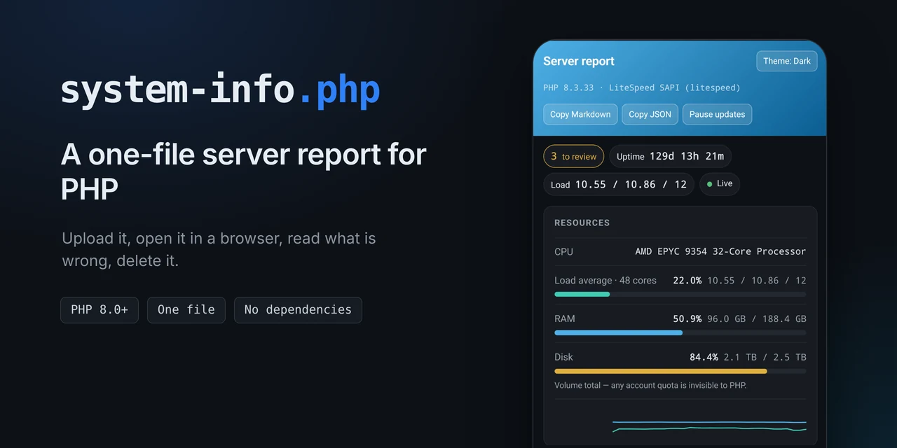
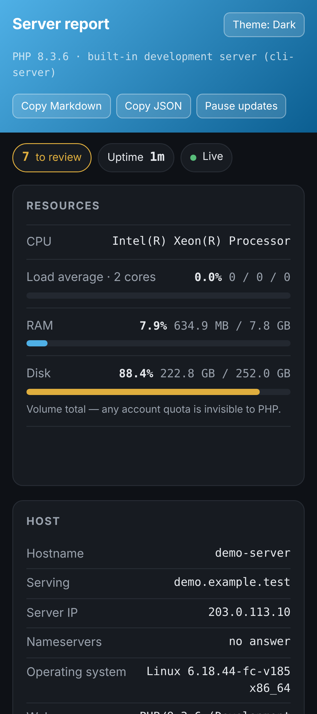
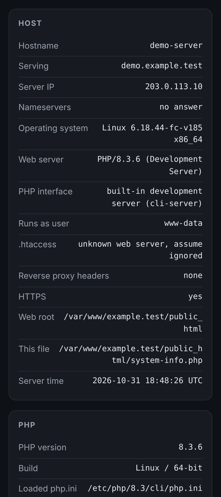
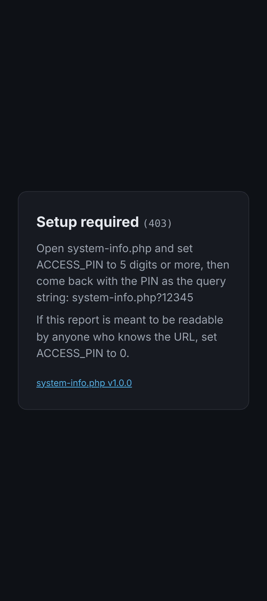
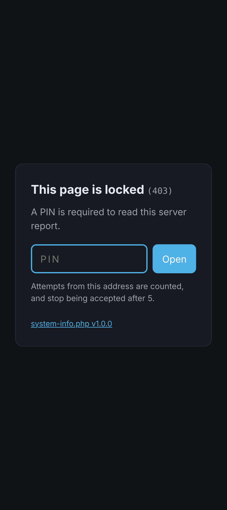
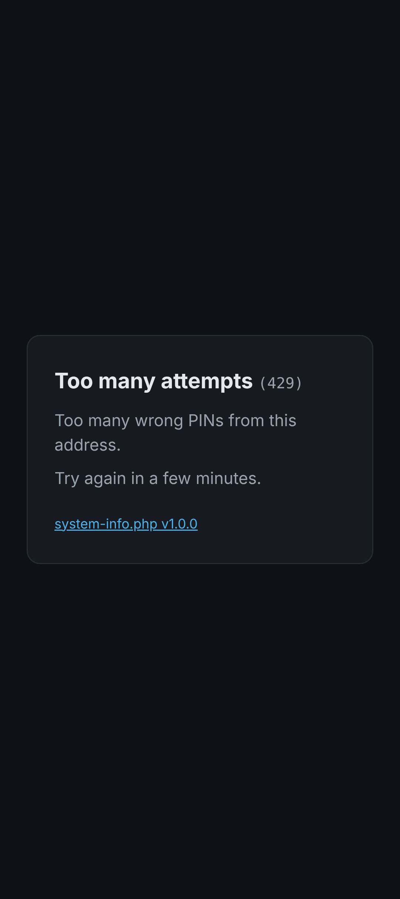

<p align="center">
  
</p>

[](https://github.com/SalvatoreNoschese/system-info.php/actions/workflows/lint.yml)
[](#requirements)
[](LICENSE)

A one-file server report for PHP. Upload it, open it in a browser, read what is
wrong, delete it.

No dependencies, no composer, no build step, no vendor directory, no outbound
traffic beyond a single DNS query you can switch off. One file goes up, one
file comes down.



## Why

`phpinfo()` tells you everything and means nothing: five hundred rows of
settings with no indication of which ones are about to cost you an afternoon.
This page starts from the other end — what is broken, what is nearly full, what
stops getting security fixes soon — and keeps the raw configuration one scroll
further down for when you need it.

## What it reports

**Resources.** Load average, RAM, swap, disk and thermal zones, with meters
that refresh in place every few seconds and turn amber past 75%, red past 90%,
and one shared trend chart underneath plotting load and RAM against the same
0-100 scale.
The CPU model sits above them, fenced off, because it is the one line there
that never changes.

The load percentage is the load average divided by the core count, so it can
pass 100%: more work is queued than the processor can clear. And the disk
figures are for the volume, not for an account quota — a quota is enforced
above the filesystem, where PHP cannot see it, so on shared hosting you will
see the provider's disk rather than the allowance you pay for. The page says
under the meters what the number is, without guessing at which kind of host it
is running on — that is not reliably detectable from inside PHP.

Thermal zones come from `/sys/class/thermal`, which means bare metal. Shared
hosting puts `/sys` behind `open_basedir`, and virtual machines and containers
usually have no thermal zones to expose, so on anything rented the row simply
does not appear.

**Caches.** OPcache and APCu from inside PHP. Redis and Memcached are found on
their own: the page sweeps the loopback ports and the usual socket paths, asks
whatever answers what it is, and reports memory, keys, hit rate, clients and
evictions. No extension required — it speaks both protocols directly — and it
tells you when a cache server is running that PHP has no client for.

**Host.** Web server, PHP handler (mod_php, PHP-FPM, LiteSpeed SAPI), the user
PHP runs as, whether `.htaccess` files are honoured here at all, and which
reverse-proxy headers are arriving. Plus the identity of the machine itself:
the domain it is answering for, the address the rest of the internet reaches
that domain at, the address the machine answers on when it is not the same
one, and the nameservers behind the domain — which is usually how you find out
the DNS is pointing somewhere you stopped paying for.

On shared hosting the machine only knows itself as the loopback, so the public
address is the one there is. When both are known and they differ, something is
sitting in between — a CDN, a load balancer, a proxy — and the checks say so.



**PHP.** The limits that actually bite — memory, execution time, upload and
POST sizes, input vars — plus which `php.ini` files are in play.

**Checks.** Around thirty findings, sorted by severity, each written as a
sentence about the consequence rather than the setting: session cookies
readable by JavaScript, `allow_url_include` left on, an end-of-life PHP branch,
a `.env` sitting in the web root, an upload limit larger than the memory limit,
an opcode cache that is full and thrashing.

**Extensions.** Grouped by what you would reach for them for, not
alphabetically, with the full loaded list one click away.

Two buttons copy the whole report as Markdown or JSON, ready to paste into a
ticket or diff against another server.

## Quick start

Download [`system-info.php`](https://raw.githubusercontent.com/SalvatoreNoschese/system-info.php/main/system-info.php) (the current version
on `main`), or straight onto the server from a shell:

```
curl -fLO https://raw.githubusercontent.com/SalvatoreNoschese/system-info.php/main/system-info.php
```

Upload it anywhere under your web root, set a PIN at the top of
the file, and open it with the PIN as the query string:

```php
const ACCESS_PIN = '12345';
```

```
https://example.com/system-info.php?12345
```

That is the whole installation. When you are done, delete the file.

Out of the box `ACCESS_PIN` is empty and the page serves nothing but a short
setup screen. Nobody publishes an open server report on purpose the first time,
so the file does not let that happen by omission: if you do want it readable by
anyone with the URL, say so explicitly with `ACCESS_PIN = '0'`.

## Protecting it

The PIN is passed as the entire query string, with no key in front of it:

```php
const ACCESS_PIN = '12345';
```

Digits only, at least five of them. Letters or a shorter PIN are treated as a
configuration error: the page stops serving entirely and says why, rather than
pretending a two-character PIN is protection. `0` is the one exception — it
means open access, deliberately. Pick something arbitrary — not `12345`, which
is the first thing anyone tries and which the checks page will flag at you.

A wrong PIN gets a `403` screen with a box to type the PIN into: explicit, and
it looks deliberate rather than broken. The box hides what you type, and once
the report has loaded the page rewrites its own address to drop the query
string — so the PIN is not in the address bar to be photographed, read over
your shoulder, or copied out when you send someone the URL.

It is kept in the tab's `sessionStorage` instead, so reloading still works and
closing the tab forgets it. Session storage on its own would not be enough —
the standard has a new tab inherit a copy of it from the tab that opened it, so
a new tab from a link would arrive already holding the PIN. The stored PIN is
therefore filed under a random marker kept in `window.name`, which survives a
reload of that tab and is empty in every other one. No marker, no match, and
the page asks. The marker is a throwaway token, never the PIN itself, because
`window.name` can be read by whatever the tab visits next.

The stored PIN also carries a deadline, `PIN_MEMORY_MINUTES`, an hour by
default. The clock restarts on every load, so a tab you are using stays open
and an idle one expires. This is not really about attackers: session storage
has no expiry of its own, and a browser that restores its tabs on startup
restores their storage with them, so without a deadline a tab reopened next
week would let you straight in. Being let in without being asked is the kind of
surprise that makes you doubt the lock. `0` remembers nothing and asks on every
load, reloads included.

Two things this does not fix. The PIN was in the URL once, so it is in the
browser's history, and an address bar that autocompletes will offer the full
URL again. And a cross-site scripting bug elsewhere on the same domain could
read the storage — an attacker with one already has the run of your site, but
it is one more place the PIN now exists. Hiding behind a `404` is tempting, but a
bare one looks nothing like the 404 page the rest of your site serves and gives
the file away just the same — so there is no option for it, and one less thing
to configure.

<table>
<tr>
<td></td>
<td></td>
<td></td>
</tr>
<tr>
<td>No PIN chosen yet: it refuses to serve.</td>
<td>A PIN is set: type it, or add it to the URL.</td>
<td>Too many wrong tries from one address.</td>
</tr>
</table>

Five wrong PINs from the same address inside five minutes return `429` until the
window expires. Throttling is the only thing that makes a five-digit PIN worth
anything — without it, 100,000 combinations fall in minutes — but it is
optional: set `RATE_LIMIT_MAX_ATTEMPTS` to `0` and the script stops writing to
disk entirely.

The counter is a single file in the system temp directory, next to the upload
scratch files PHP already puts there, named after a hash of the script's own
path so two installations never collide. It holds hashed addresses and counts,
nothing else. Nothing is written to the web root and nothing needs deleting by
hand — the machine cleans its own temp directory. `RATE_LIMIT_PATH` moves the
file if you want it somewhere specific.

The PIN is a doorbell, not a lock: it travels in the URL, so it lands in server
logs, and in the browsing history of whatever machine opened it. Clearing it
from the address bar keeps it out of screenshots and out of URLs you copy; it
does not take it back out of history, and an address bar that autocompletes
will happily offer the full URL again — in a new tab, and in a private window,
which still suggests from ordinary history. Serve the page over HTTPS, and if
you want a real lock, use your web server's own authentication.

<details>
<summary>Apache and LiteSpeed</summary>

```apache
<Files "system-info.php">
	AuthType Basic
	AuthName "Restricted"
	AuthUserFile /path/to/.htpasswd
	Require valid-user
</Files>
```
</details>

<details>
<summary>nginx — .htaccess files are ignored, this goes in the server block</summary>

```nginx
location = /system-info.php {
	auth_basic "Restricted";
	auth_basic_user_file /etc/nginx/.htpasswd;
	include fastcgi_params;
	fastcgi_pass unix:/run/php/php-fpm.sock;
	fastcgi_param SCRIPT_FILENAME $document_root$fastcgi_script_name;
}
```
</details>

<details>
<summary>Caddy</summary>

```caddyfile
@sysinfo path /system-info.php
basic_auth @sysinfo {
	admin <bcrypt-hash>
}
```
</details>

The page detects which of these you are running and says so, including the case
where `.htaccess` does nothing at all.

## Configuration

`ACCESS_PIN` is the only setting you are likely to ever touch, and it sits at
the top of the file, before anything else runs. Everything below is a constant
too, further down under "advanced settings", for the rare case you want to
override one. The minimum PIN length is not among them: a floor you can lower
is not a floor, and a longer PIN is yours to type.

| Constant | Default | What it does |
| --- | --- | --- |
| `ACCESS_PIN` | `''` | PIN required to view the page. Empty asks for setup, `'0'` means open. |
| `RATE_LIMIT_PATH` | `''` | Counter file. Empty means the system temp directory. |
| `DISK_PATHS` | `[__DIR__]` | Paths to report disk usage for. Add mount points on a VPS; on shared hosting they all answer for the same volume. |
| `REFRESH_SECONDS` | `5` | Live update interval. `0` turns polling off. |
| `PIN_MEMORY_MINUTES` | `60` | How long a tab may reuse its PIN across reloads. `0` asks every time. |
| `DNS_LOOKUPS` | `true` | Resolve the served domain and its nameservers. The only queries that leave the machine. |
| `RATE_LIMIT_MAX_ATTEMPTS` | `5` | Failed PINs before a `429`. `0` disables throttling. |
| `RATE_LIMIT_WINDOW_SECONDS` | `300` | How long that lasts. |
| `CACHE_AUTODETECT` | `true` | Sweep the well-known cache addresses. |
| `REDIS_SERVERS` | `[]` | Extra addresses to check, on top of the sweep. |
| `MEMCACHED_SERVERS` | `[]` | Same. Either list accepts either kind of server. |
| `CACHE_CANDIDATES` | see file | The addresses the sweep tries. |
| `PROBE_TIMEOUT_SECONDS` | `0.3` | Connect and read timeout for the cache probes. |

## Finding your cache

Nothing needs configuring in the usual case. The sweep tries `127.0.0.1:6379`,
`127.0.0.1:11211` and the socket paths Redis, Memcached and LSMCD normally use.
A missing socket file or a closed local port fails immediately, so the sweep
costs nothing when there is nothing to find.

If your server listens somewhere else, add it to either list. The type is
detected from the answer, so it does not matter which list you put it in:

```php
const REDIS_SERVERS = ['/tmp/redis.sock', '10.0.0.5:6379'];
```

Every one of these forms works, including the host-and-port shape that
WordPress cache plugins ask for:

```
127.0.0.1:6379    /tmp/redis.sock    unix:/tmp/redis.sock    /tmp/redis.sock:0
```

Ports belong to TCP only: a unix socket is a file, addressed by path, so the
socket entries in `CACHE_CANDIDATES` carry no port and a trailing `:0` on one
is ignored.

The probe opens one connection per address and asks one question: `INFO` as an
inline command. Redis replies with a bulk string, or an auth error if it is
locked down; Memcached replies `ERROR`, which is how it identifies itself, and
gets a `stats` instead. Nothing is written, nothing is stored, no keys are read.

## Live updates

The page polls itself at `?<pin>&live=1` and rewrites only the values that can
change. That endpoint returns metrics as JSON and nothing else — no checks, no
extension list, no configuration dump.

Polling stops while the tab is in the background, and stops for good after
three failed attempts rather than hammering a server that is clearly busy.
`REFRESH_SECONDS = 0` disables it entirely and leaves a static page.

## Command line

```
php system-info.php > report.md
```

Same report, as Markdown. The CLI ignores the PIN: if you already have a shell
on the box, it is not protecting anything from you.

## Requirements

PHP 8.0 or newer. Older versions get a one-line message instead of a parse
error.

Everything degrades on its own. No `/proc` — shared hosting, `open_basedir` —
hides the host metrics and says why. No Redis on the wire hides the Redis card.
Windows hides what Windows does not expose. No section takes the page down with
it.

## What it does not do

- No outbound requests, with one exception: two DNS lookups for the domain
  being served — its address and its nameservers — which ask your own resolver
  questions it already knows the answers to. Nothing about your server is sent
  anywhere. Set `DNS_LOOKUPS = false` and even that stops, which is worth doing
  on a host that filters outbound DNS, where the lookup waits for the resolver
  to time out.
- No writes, except the failed-PIN counter in the temp directory, and only when
  a PIN is set and someone gets it wrong.
- No cookies, no sessions, no analytics, no CDN, no fonts fetched from anywhere.
- Read-only against your cache servers.

`Content-Security-Policy`, `X-Frame-Options`, `noindex` and `no-store` are set
on every response, and the inline script runs under a per-request nonce.

## Contributing

The constraints this file keeps — one file, PHP 8.0 syntax, nothing written
outside the temp directory, nothing fetched from anywhere — are the reason it
is safe to drop on a server you do not control. [CONTRIBUTING.md](CONTRIBUTING.md)
spells them out. Found a way to read the report without the PIN? That one goes
in [SECURITY.md](SECURITY.md), not in a public issue.

## License

MIT. See [LICENSE](LICENSE).
